

**A collection of projects I've built.**
Source code is private. Live demos are linked below.

---

## 🌐 Live Projects

<table>
<tr>
<td align="center" width="33%">
<a href="https://mehadi-hasan-cse.netlify.app">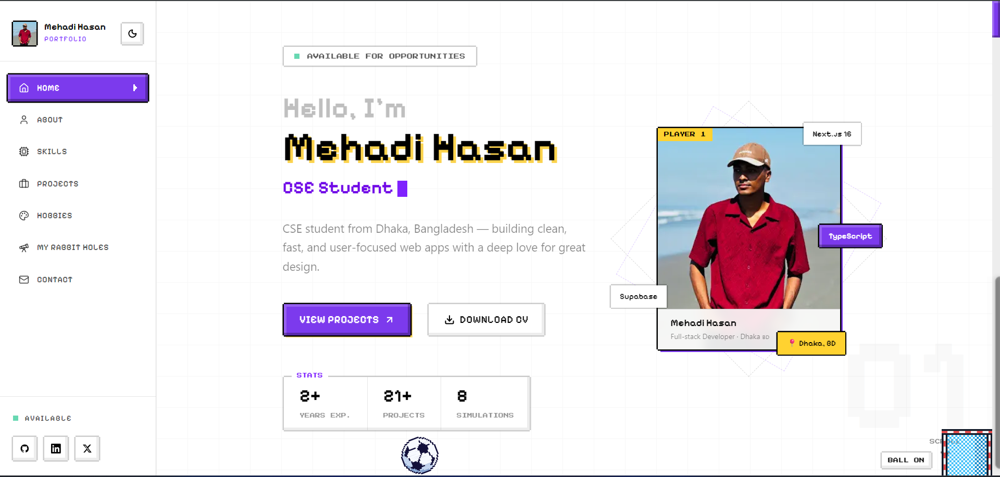</a> 
<b>Portfolio</b> 
Personal developer portfolio  

</td>
<td align="center" width="33%">
<a href="https://cgcp-bd.vercel.app">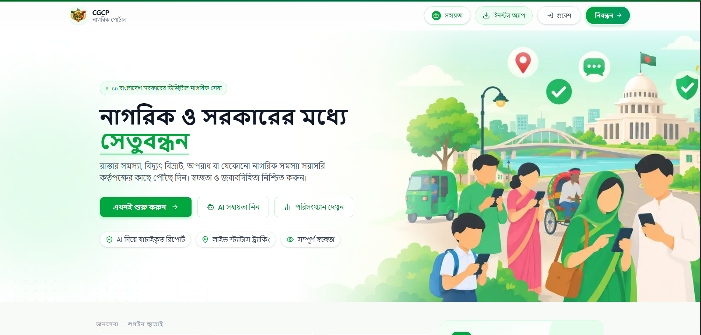</a> 
<b>CGCP</b> 
Civic reporting with AI verification & voice-enabled law chatbot  

</td>
<td align="center" width="33%">
<a href="https://kacher-dokan.vercel.app">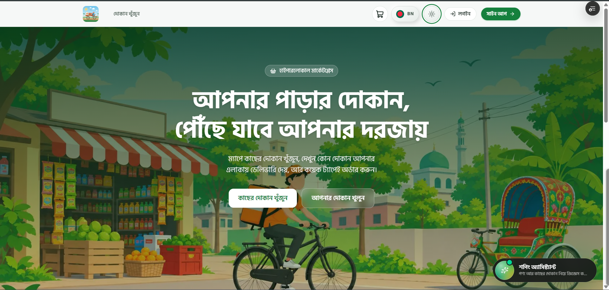</a> 
<b>Kacher Dokan</b> 
Hyperlocal marketplace for neighborhood shops  

</td>
</tr>
<tr>
<td align="center">
 
<b>Space-viz</b> 
Interactive 3D universe built with Three.js & GLSL shaders  

</td>
<td align="center">
<a href="https://nixbird.com">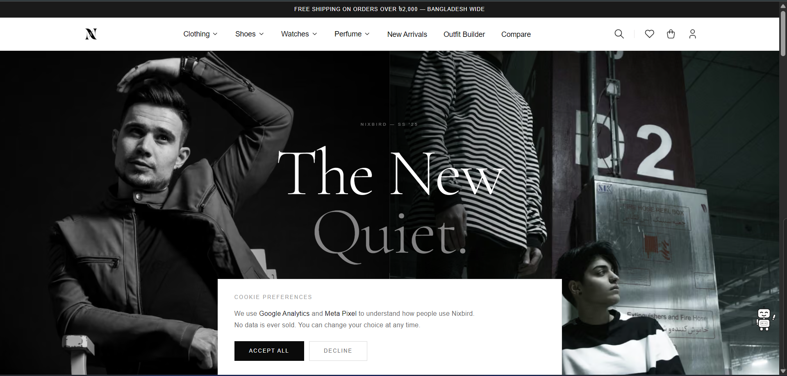</a> 
<b>Nixbird</b> 
Fashion store with COD, bKash send money & Steadfast API  

</td>
<td align="center">
<a href="https://rickshaw-bhara.vercel.app">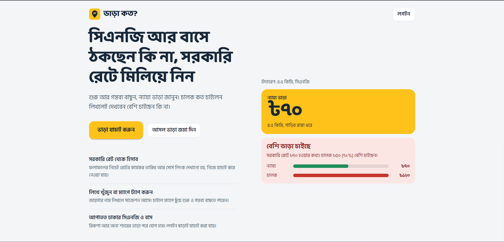</a> 
<b>Rickshaw Bhara</b> 
Check if your CNG or bus driver is overcharging  

</td>
</tr>
<tr>
<td align="center">
 
<b>Snapzen</b> 
Privacy-first image toolkit with AI background remover  

</td>
<td align="center">
<a href="https://keyra-vault.vercel.app">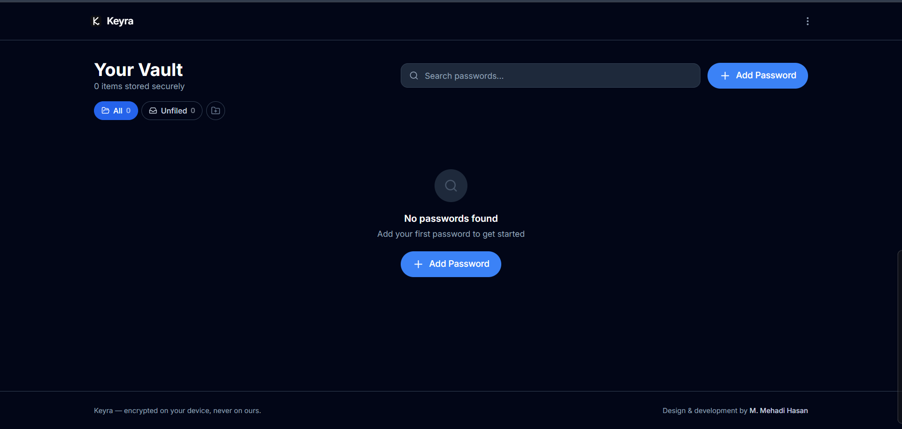</a> 
<b>Keyra Vault</b> 
Zero-knowledge password manager with offline PWA  

</td>
<td align="center">
<a href="https://smart-doto.vercel.app">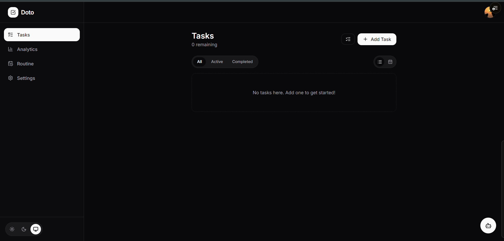</a> 
<b>Smart Doto</b> 
AI-powered to-do PWA with push reminders  

</td>
</tr>
<tr>
<td align="center">
 
<b>Uptime Monitor</b> 
Website & API uptime monitor with Telegram/Discord alerts  

</td>
<td align="center">
<a href="https://filmlyz.netlify.app">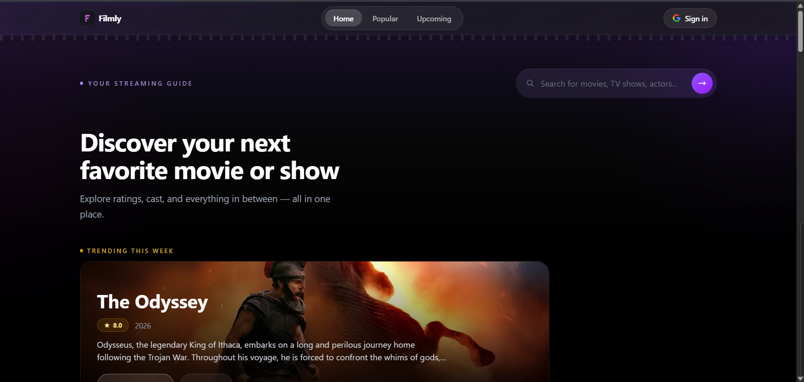</a> 
<b>Filmlyz</b> 
Movie & TV tracker with ratings, lists & episode progress  

</td>
<td align="center">
 
<b>Repo Explainer</b> 
AI onboarding guide for any public GitHub repo  

</td>
</tr>
<tr>
<td align="center">
 
<b>World Explore</b> 
Explore countries of the world  

</td>
<td></td>
<td></td>
</tr>
</table>

---

## 🧰 Python & C Projects

These run on your own computer, so there is no live link.

<table>
<tr>
<td align="center" width="50%">
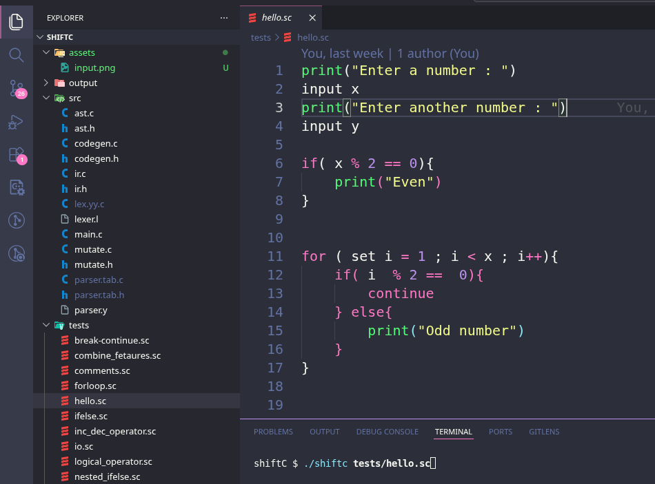 
<b>ShiftC</b> 
Custom programming language compiler with code mutation  

</td>
<td align="center" width="50%">
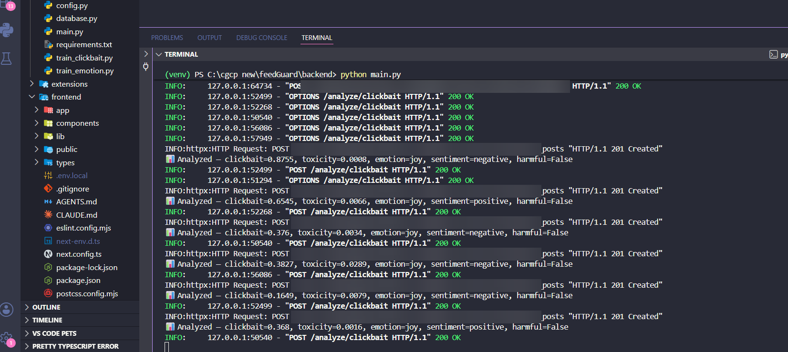 
<b>FeedGuard</b> 
AI Chrome extension that flags harmful Facebook posts (English + Bangla)  

</td>
</tr>
<tr>
<td align="center">
 
<b>NetSpy</b> 
Real-time network packet sniffer & security analyzer  

</td>
<td align="center">
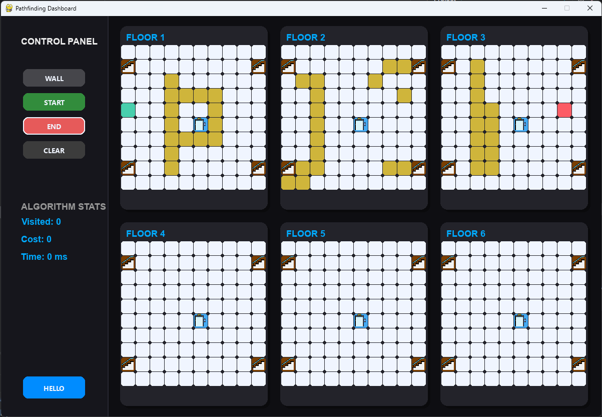 
<b>RobotPathfinder</b> 
Multi-floor A* pathfinding visualizer with elevators and stairs  

</td>
</tr>
</table>

---

## 📂 Code Available on Request

Source code is private. If you would like to see the code, please email:

- 📧 mehedihassan6838@gmail.com
- 📧 mehadi.hsasn.life@gmail.com

---

© 2026 Md. Mehadi Hasan. All rights reserved.

